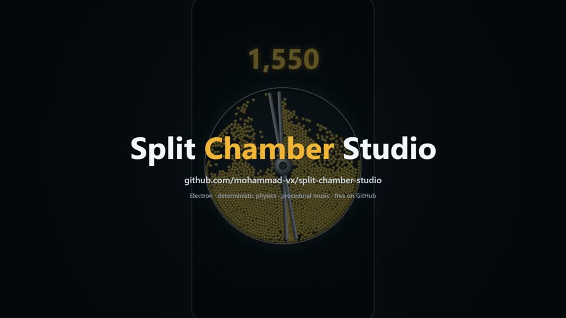

# Split Chamber Studio

[](docs/media/promo.mp4)

*32-second promo, made from the app's own footage: [watch it](docs/media/promo.mp4).*

A desktop tool that **generates satisfying ball-simulation videos automatically**. You choose a pattern, how many videos you want and the caption language, then press **Generate**. Every video is:

- simulated deterministically, so it can be reproduced exactly from its seed;
- checked automatically (length, a hook in the first seconds, stability, emptiness, loudness, frozen picture, duplicates);
- rendered as a small preview for you to review.

Videos you accept are rendered as a verified **1080×1920 · 60 fps** master with synchronized sound effects and music.

**Live play** opens the game (any of the 7 patterns, sessions, manual export). While a batch is running the same button becomes **● Watch live** and shows the video being made right now.

Press **How it works** in the Studio for the whole flow; select any video to see every check it went through (✓/✗, measured value, limit) and how its score was calculated. After every batch the **Last batch** panel shows how many videos were requested, how many wait for review, how many were rejected and why.

---

## Start it

- **Portable:** `dist\SplitChamberStudio-2.0.0-portable.exe`. Nothing to install.
- **Installer:** `dist\SplitChamberStudio-2.0.0-setup.exe`.
- **From the project folder:** double-click `Start Split Chamber.bat`. This needs `npm install` to have been run once.

## Making videos

1. Press **+ Generate**.
2. Choose a **pattern** (or *Random*), the **number of videos** (1, 5, 10, 20, 50 or any number) and the **text** (English, Arabic or none).
3. Press **Start**. The bar shows the current video, the stage (simulate, soundtrack, preview, checks) and progress. **Stop** ends the batch.
4. Candidates appear under **Waiting for review**, sorted by score. Videos that fail a check are rejected automatically, with the reason shown under **Rejected**.
5. Select a candidate:
   - **▶ Play** (or Enter) watches the preview.
   - **✓ Accept** (or A) renders the full master and verifies it.
   - **✗ Reject** (or R): tick a reason first (boring, too similar, glitch, audio, other).
6. Accepted videos:
   - **Reproduce** re-runs the simulation and proves every frame is identical (it re-renders the master if you deleted it).
   - **Export EN / AR / no-text version** renders the same video with another caption, without re-simulating.
   - **New variation** generates the same pattern with a new seed.
   - **Delete master** frees space; the video stays reproducible.

**Auto-accept score ≥ N** (in the Generate panel, off by default) accepts high-scoring candidates without review. That's the "hybrid" mode for when you trust the score.

### Patterns

| Pattern | What happens |
|---|---|
| **Split Chamber** | Four presses; every crushed ball splits into three, until 10,000 balls and a gold finale |
| **Orbit Crusher** | Balls orbit a gravity well; rotating blades cut the orbits |
| **Rotary Sweeper** | Rotating arms sweep colliding balls against wedges; the pile grows until the glass rim breaks |
| **Scissor Jaws** | V-shaped jaws on a hub open, close and turn |
| **Melodic Rams** | Two pendulum rams with hammer heads; every swing is a little faster |
| **Kaleidoscope Press** | Triangles contract into a mandala and release |
| **Press Walls** | Two walls slide in and squeeze everything between them |

In Rotary Sweeper, Scissor Jaws, Melodic Rams, Kaleidoscope Press and Press Walls (version 2), **every ball squeezed between a moving part and a wall or another part splits**: nothing is left to chance. The finale starts when the arena is full or at 40 s.

Videos are **30–50 s** (Split Chamber 30–40 s, Orbit Crusher 30–45 s).

### Where things are

| What | Where |
|---|---|
| Library (default, change in settings) | `D:\Split Chamber Studio\` — one folder per video in `videos\<id>\` |
| Per video | `config.json` (everything needed to reproduce), `metrics.json`, `status.json`, `thumb.jpg`, `preview.mp4`, `master.mp4` (accepted only) |
| Quota | 12 GB (about 50 forty-second masters); the bar at the top shows usage |
| Live-play exports (old mode) | `%USERPROFILE%\Videos\Split Chamber\` |
| Log | `%APPDATA%\Split Chamber Studio\logs\main.log` |

### What is checked automatically

| Stage | Checks |
|---|---|
| Simulation | Stable (no invalid numbers), reaches its climax, length within the pattern's range, first split within 3 s, scene not empty |
| Preview (encoded file) | Loudness −17…−13 LUFS, true peak ≤ −1 dBTP, no silence over 1.5 s, no frozen or black picture over 1 s, not too similar to an accepted video (growth curve + perceptual frame hashes) |
| Master | Exact resolution, 60/1 fps, exact frame count (every frame decoded), duration, audio; SSIM ≥ 0.94 (min) / 0.96 (mean) against frames rendered directly by the engine; frame accuracy N/N; loudness re-checked. Every re-simulation must reproduce the per-frame state hashes of the original run. |

If an encoder fails a check, the next one is tried: MediaBunny hardware → FFmpeg GPU → MediaBunny software → x264.

## Command line

Headless batch: no window, no sound, prints a JSON result line.

```bash
node_modules\electron\dist\electron.exe . --generate=5 --pattern=random --captions=ar
```

Options: `--pattern=<key>` (`split-chamber@2`, `orbit-crusher@1`, `rotary-sweeper@2`, `jaws@2`, `rams@2`, `kaleidoscope@2`, `walls@2`; the older `@1` versions still reproduce), `--seeds=1,2,3`, `--accept-all`, `--library=<folder>`, `--quota-mb=<n>`, `--mute`.

## For developers

```bash
npm install
```

```bash
npm test
```

```bash
npm run gate
```

```bash
npm run gate:pixels
```

```bash
npm run test:e2e
```

```bash
npm run dist
```

- `npm test`: 41 unit tests.
- `npm run gate`: determinism gates (Node + Electron, all scenario goldens).
- `npm run gate:pixels`: byte-exact render check on this machine.
- `npm run test:e2e`: 17 Playwright tests on the real app (muted).
- `npm run dist`: portable exe + installer.

Tools: `tools/scenario-check.mjs <key>` (validates seeds against the run checks), `tools/benchmark-pipeline` notes in `docs/BENCHMARK.md`, `tools/compare.mjs` (encoder quality), `tools/pixelgate.mjs`, `tools/goldens.mjs`, `tools/baseline.mjs`.

Architecture: [docs/ARCHITECTURE.md](docs/ARCHITECTURE.md). Implementation log and findings: [docs/PROGRESS.md](docs/PROGRESS.md). Measurements: [docs/BENCHMARK.md](docs/BENCHMARK.md).

### Dependencies

`electron` 45, `mediabunny` (WebCodecs MP4), `ffmpeg-static` (FFmpeg 6.1: fallback encoders, remux, analysis), `ffprobe-static` (verification); dev: `electron-builder`, `@playwright/test`. No network services.

## Known limitations

- **Windows x64 only.** Pixel-exact reproduction is guaranteed on the same machine and GPU driver. The simulation itself is bit-exact across Node and Electron for all new engines; the legacy Split Chamber@1 engine is exact only within Electron.
- **Sound is checked by measurement, not by ear.** Procedural music quality is subjective; your review is the judge.
- **Packed scenarios hold about 1,200–2,200 balls**, Swarm scenarios 10,000.
- **Some seeds are rejected automatically right after simulating** (≈ 3 s each): Rotary Sweeper about 1 in 3 (climax too small or too fast), the other patterns rarely.
- **The long multi-act mode (up to 3 min) and the claw/gantry mechanism are not built yet.**
- **The app is not code-signed**, so SmartScreen may ask once ("More info → Run anyway").
